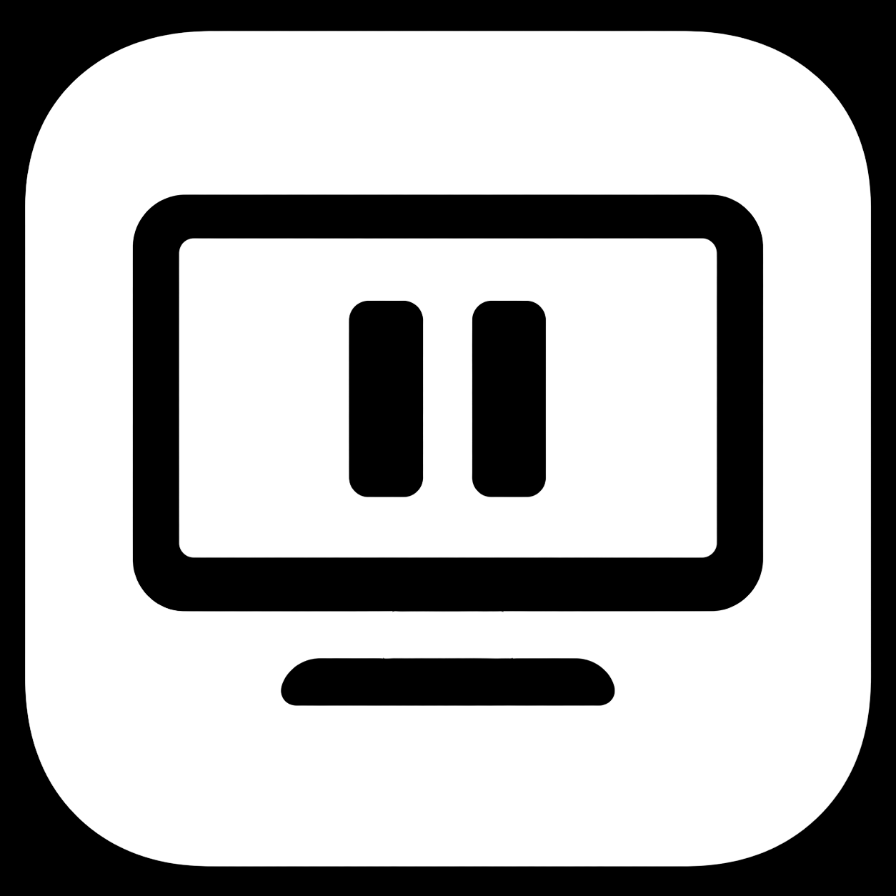
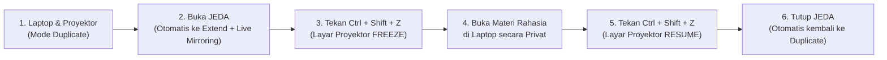

<p align="center">
  
</p>

<h1 align="center">JEDA</h1>

<p align="center">
  <strong>Pause the Screen, Keep Working.</strong><br>
  <em>Utilitas Desktop Windows untuk Membekukan Tampilan Monitor Proyektor Presentasi secara Instan.</em>
</p>

<p align="center">
  
  
  
  
  
</p>

---

## 📌 Daftar Isi
- [Tentang JEDA](#-tentang-jeda)
- [Alur Kerja Presenter (User Flow)](#-alur-kerja-presenter-user-flow)
- [Fitur Utama](#-fitur-utama)
- [Unduh Rilis (Downloads)](#-unduh-rilis-downloads)
- [Panduan Penggunaan](#-panduan-penggunaan)
- [Kontrol & Pintasan (Shortcuts)](#-kontrol--pintasan-shortcuts)
- [Kebutuhan Sistem](#-kebutuhan-sistem)
- [Membangun dari Source Code](#-membangun-dari-source-code)
- [Arsitektur Teknis](#-arsitektur-teknis)
- [Lisensi](#-lisensi)

---

## 💡 Tentang JEDA

Ketika melakukan presentasi di depan kelas, seminar, atau rapat, sebagian besar pembicara lebih nyaman menggunakan mode **Duplicate Screen** (`Win + P` $\rightarrow$ Duplicate) karena apa yang terlihat di layar laptop sama persis dengan yang dilihat audiens di proyektor.

Namun, pada mode Duplicate biasa:
- Anda **tidak dapat** membuka kunci jawaban, soal ujian, catatan pribadi, WhatsApp, atau mencari referensi di Google tanpa langsung terlihat oleh audiens di proyektor.
- Jika beralih ke mode **Extended Display** manual, layar proyektor menjadi kosong dan Anda harus repot menggeser jendela aplikasi ke layar kedua.

**JEDA hadir sebagai solusi terbaik untuk presenter modern.**  
JEDA secara cerdas menjembatani kenyamanan mode Duplicate dengan privasi mode Extend.

---

## 🔄 Alur Kerja Presenter (User Flow)



1. **Awal:** Anda menghubungkan proyektor dalam mode bawaan Windows: **Duplicate Screen**.
2. **Buka JEDA:** JEDA otomatis mengubah topologi display ke **Extend**, tetapi langsung menjalankan **Live Mirroring** resolusi tinggi. Audiens tetap melihat tampilan yang sama persis seperti duplicate (tidak ada layar kosong!).
3. **Tekan `Ctrl + Shift + Z`:** Layar proyektor seketika **membeku (Freeze)** pada slide terakhir.
4. **Bebas Bekerja Privat:** Anda bebas membuka materi ujian, catatan rahasia, atau browsing di laptop tanpa khawatir bocor ke layar proyektor.
5. **Tekan `Ctrl + Shift + Z` Lagi:** Layar proyektor kembali melanjutkan siaran langsung (**Resume**).
6. **Keluar:** Saat JEDA ditutup, mode tampilan Windows otomatis dikembalikan ke **Duplicate Screen**.

---

## ✨ Fitur Utama

- 🎯 **Zero-Configuration:** Tidak perlu memilih monitor atau mengatur resolusi secara manual. Begitu dibuka, JEDA langsung mendeteksi proyektor/layar eksternal dan siap digunakan.
- ⚡ **Global Hotkey (`Ctrl + Shift + Z`):** Shortcut global tingkat sistem (Win32 `RegisterHotKey`). Bekerja kapan saja meskipun Anda sedang membuka PowerPoint slide show layar penuh (*fullscreen*), PDF, Word, atau Chrome.
- 🖥️ **Smart Window Relocation:** Jika Anda membuka aplikasi baru (seperti Google Chrome atau Notepad) saat proyektor sedang dibekukan, JEDA secara otomatis memindahkan jendela tersebut ke layar utama laptop Anda agar tidak tertutup di balik layar freeze.
- 🎛️ **Ikon Cerdas di System Tray:**
  - 🔵 **Monitor Play Biru:** Menandakan layar proyektor sedang aktif (*Live / Resume*).
  - 🔴 **Monitor Pause Merah:** Menandakan layar proyektor sedang dikunci (*Freeze*).
- 🔍 **Ketajaman Visual HD (PerMonitorV2 High DPI):** Menggunakan kesadaran DPI tingkat lanjut sehingga tampilan di layar eksternal tetap 100% HD tanpa blur atau masalah zoom/cropping.
- 🍃 **Sangat Ringan & Efisien:** Menggunakan arsitektur *Workstation Garbage Collection* dan pembersihan *working set* otomatis. Konsumsi RAM hanya **~70–90 MB** (jauh lebih hemat dibanding utilitas sejenis yang mencapai 250+ MB).

---

## 📥 Unduh Rilis (Downloads)

Versi stabil terbaru: **v1.0.0**

| Paket Distribusi | Tipe | Deskripsi | Unduh |
|---|---|---|:---:|
| **JEDA Portable** | `.zip` | Siap pakai tanpa instalasi. Cukup ekstrak dan jalankan `Jeda.exe`. | [Unduh Portable v1.0.0](release/Jeda-v1.0.0-Portable-win-x64.zip) |
| **JEDA Installer** | `.zip` | Paket pemasang otomatis. Dilengkapi `Setup.bat` untuk membuat pintasan di Desktop & Start Menu. | [Unduh Installer v1.0.0](release/Jeda-v1.0.0-Installer-win-x64.zip) |
| **Inno Setup Script** | `.iss` | Skrip instalasi resmi Inno Setup 6 untuk membangun installer kustom. | [Lihat Skrip](installer/JedaSetup.iss) |

### Verifikasi Keaslian Berkas (Checksums SHA-256)
```text
6688bdabe43f78e3cf6072f6b5a01a54298c1f173bcfc393676312ec8c975959  Jeda-v1.0.0-Portable-win-x64.zip
7699a062764564589a096cc9b78cd82b74d566041f37d9745d8f8994e482203e  Jeda-v1.0.0-Installer-win-x64.zip
```

---

## 🚀 Panduan Penggunaan

### Menggunakan Versi Portable
1. Unduh `Jeda-v1.0.0-Portable-win-x64.zip`.
2. Ekstrak berkas zip ke folder pilihan Anda.
3. Jalankan `Jeda.exe`.

### Menggunakan Versi Installer
1. Unduh `Jeda-v1.0.0-Installer-win-x64.zip` dan ekstrak.
2. Klik dua kali pada berkas `Setup.bat`.
3. JEDA akan terpasang di `%LOCALAPPDATA%\Programs\Jeda` dan membuat pintasan di Desktop serta Start Menu.
4. Untuk menghapus instalasi, cukup jalankan `Uninstall.bat` atau hapus melalui Windows Settings (*Installed Apps*).

---

## ⌨️ Kontrol & Pintasan (Shortcuts)

| Tindakan | Kontrol / Shortcut | Keterangan |
|---|---|---|
| **Freeze / Resume Layar** | `Ctrl + Shift + Z` | Beralih antara membekukan layar proyektor dan melanjutkan siaran langsung. |
| **Minimize ke System Tray** | Klik tombol Minimize (`_`) | Jendela bersembunyi ke pojok kanan bawah dekat jam Windows. |
| **Buka Jendela Utama** | Klik ganda ikon Tray | Menampilkan kembali antarmuka JEDA ke layar depan. |
| **Menu Opsi Cepat** | Klik kanan ikon Tray | Menyediakan menu *Tampilkan JEDA*, *Freeze/Resume*, dan *Keluar*. |
| **Tutup Aplikasi** | Klik `[X]` atau pilih *Keluar* | Menghentikan overlay dan otomatis mengembalikan Windows ke mode Duplicate. |

---

## 💻 Kebutuhan Sistem

- **Sistem Operasi:** Windows 10 (versi 1809 ke atas) atau Windows 11.
- **Arsitektur:** 64-bit (x64).
- **Perangkat Keras:** Laptop/PC dengan minimal 1 display eksternal atau proyektor terhubung.
- **Runtime:** [.NET 10 Desktop Runtime](https://dotnet.microsoft.com/download/dotnet/10.0) (Windows x64).

---

## 🛠️ Membangun dari Source Code

Jika Anda ingin mengompilasi JEDA sendiri dari source code:

1. **Prasyarat:**
   - [.NET 10 SDK](https://dotnet.microsoft.com/download/dotnet/10.0) terpasang.
   - Git.

2. **Clone repositori:**
   ```powershell
   git clone https://github.com/username/jeda.git
   cd jeda
   ```

3. **Kompilasi mode Release:**
   ```powershell
   dotnet build src/Jeda/Jeda.csproj -c Release
   ```

4. **Jalankan aplikasi:**
   ```powershell
   & "src/Jeda/bin/Release/net10.0-windows/Jeda.exe"
   ```

5. **Jalankan Verifikasi Unit Test (Milestone M7):**
   ```powershell
   dotnet run --project tests/Jeda.Verifier/Jeda.Verifier.csproj
   ```

---

## 🏗️ Arsitektur Teknis

```
C:\Codes\jeda\
├── docs\
│   └── PRD.md                       # Product Requirements Document
├── src\
│   └── Jeda\
│       ├── Assets\                  # Logo resmi, app.ico, dan jeda-icon.svg
│       ├── Models\                  # AppStatus, MonitorInfo
│       ├── Native\                  # Win32 API Interop (Hotkeys, Topology, DpiAwareness)
│       ├── Services\                # Topology, Freeze, Hotkey, Tray, Monitor, Capture
│       ├── Utilities\               # MemoryOptimizer (Working set trim & GC)
│       ├── ViewModels\              # MainViewModel (MVVM Pattern)
│       └── Views\                   # MainWindow.xaml, FreezeOverlayWindow.xaml
├── tests\
│   └── Jeda.Verifier\               # M7 Automated Verification Suite
├── installer\
│   └── JedaSetup.iss                # Skrip Inno Setup 6
├── dist\                            # Direktori rakitan rilis
└── release\                         # Arsip rilis resmi (.zip & SHA256SUMS)
```

---

## 📄 Lisensi

Proyek ini dilisensikan di bawah lisensi **MIT License** — bebas digunakan, dimodifikasi, dan didistribusikan untuk keperluan personal maupun komersial.

```
JEDA – Pause the Screen, Keep Working.
Copyright (c) 2026 JEDA Open Source Contributors.
```

